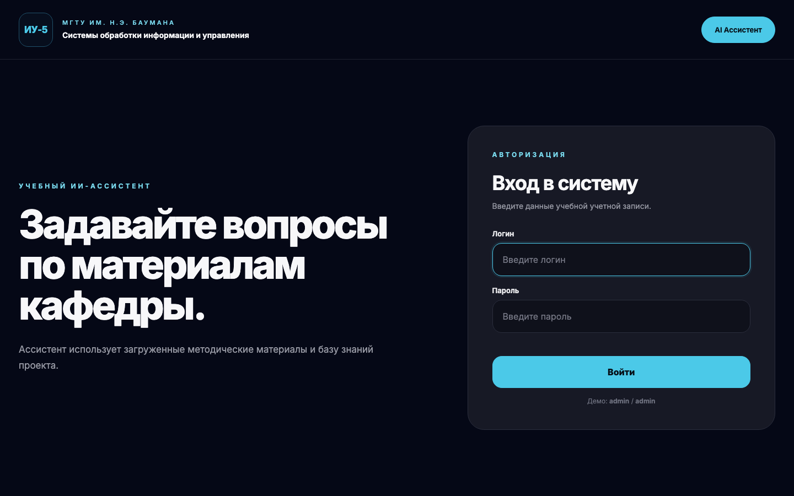
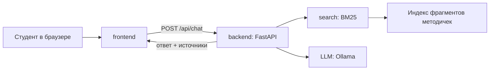

# RAG-ассистент кафедры ИУ-5

Русскоязычный чат-помощник по учебно-методической документации кафедры ИУ-5 МГТУ им. Н. Э. Баумана: поиск фрагментов методичек через BM25 и ответ локальной LLM со ссылкой на источник.


## Тема и пользователь

**Тема НИРС:** исследование эффективности RAG-системы для поиска и обработки учебно-методической документации кафедры ИУ-5.

**Пользователь:** студент кафедры, которому нужно быстро найти требования к лабораторной работе, курсовому проекту или дисциплине и проверить ответ по исходной методичке. Дополнительно — преподаватель, который хочет понять, что ассистент отвечает студентам.

Пример задачи: «Какие разделы должны быть в отчёте по лабораторной работе №3?». Студент входит в систему, задаёт вопрос, получает краткий ответ и видит источник: название методички и страницу.

## Что готово сейчас

| Материал | Статус |
| --- | --- |
| Продуктовые и технические спецификации | Подготовлены, см. [spec/](spec/) |
| Интерфейс | Статический прототип: вход, чат, история диалогов, адаптивная вёрстка — [frontend/](frontend/) |
| Контракт API чата | Описан в [spec/tech/api.md](spec/tech/api.md); точка подключения в `frontend/script.js` |
| Корпус | 30 документов `D01…D30` (1 курс, 1 семестр), извлечённый текст — [corpus/](corpus/) |
| BM25-поиск | Собственный индекс, лемматизация, отказ без контекста — [search/](search/), 24 теста |
| Benchmark | 10 вопросов + 5 ловушек, запуск в рантайме: Recall@5 = 0.960, MRR@5 = 1.000 — [benchmark/](benchmark/) |
| Backend, LLM | В работе по [ТЗ точки 2](docs/checkpoint-2.md) |

Ответы в прототипе — демонстрационные: они явно помечены как «демо-ответ» и не являются работой RAG.

**Сейчас идёт работа над второй контрольной точкой** (RAG и benchmark). Задачи каждого участника, контракты между частями и чек-лист — в [ТЗ точки 2](docs/checkpoint-2.md).

## Запуск прототипа

Внешние зависимости не нужны. Достаточно открыть `frontend/index.html` в современном браузере или поднять локальный сервер:

```bash
python3 -m http.server 8080 --directory frontend
```

Затем открыть http://localhost:8080 и войти с демо-учётной записью **admin / admin**. История диалогов хранится в `localStorage` браузера.

| Вход | Новый диалог |
| --- | --- |
|  |  |

## Поиск и benchmark

Нужен Python 3.12+.

```bash
python -m venv .venv
.venv/Scripts/activate            # Windows; на Linux/macOS: source .venv/bin/activate
pip install -r requirements.txt
python -m search.build            # собрать BM25-индекс из corpus/processed (~2 с)
python -m benchmark.run           # benchmark в рантайме: Recall@5, MRR@5, отказ на ловушках
python -m pytest                  # тесты поиска и benchmark
```

С ответами LLM, когда запущен backend: `python -m benchmark.run --mode full --api http://localhost:8000` — добавляются Accuracy и Correct Rejection Rate по ответам. Результаты сохраняются в `benchmark/results/`. Подробности — [benchmark/README.md](benchmark/README.md), [search/README.md](search/README.md), [corpus/README.md](corpus/README.md).

## Архитектура рабочей версии

| Сервис | Технология | Назначение |
| --- | --- | --- |
| frontend | HTML, CSS, JavaScript (текущий прототип) | Вход, чат, история, отображение источников |
| backend | Python 3.12, FastAPI | API чата, сборка контекста, вызов поиска и LLM |
| search | Python, rank-bm25, pymorphy3 | Индекс фрагментов методичек, BM25-поиск |
| llm | Ollama, открытая instruct-модель (выбирается по benchmark) | Генерация ответа по найденным фрагментам |
| corpus | PDF/DOCX → Markdown → фрагменты + metadata | Подготовленная база знаний кафедры |

Путь запроса: браузер → backend → BM25-поиск → backend (prompt) → LLM → backend → браузер с ответом и источниками. Подробнее — [spec/tech/architecture.md](spec/tech/architecture.md).



## Структура репозитория

```text
.
├── README.md               описание проекта и запуск
├── CONTRIBUTING.md         правила проекта: ветки, Pull Request, review
├── CHANGE_HISTORY.md       журнал значимых изменений
├── frontend/               статический прототип интерфейса
├── backend/                будущий FastAPI-сервис (сейчас README с границами)
├── search/                 будущий BM25-поиск
├── corpus/                 формат корпуса методичек
├── benchmark/              формат вопросов и пример
├── spec/
│   ├── product/            продукт, сценарии, интерфейс
│   ├── tech/               архитектура, API, RAG, проверка
│   ├── team.md             команда и зоны ответственности
│   ├── plan.md             план и контрольные точки
│   └── decisions.md        журнал решений
├── docs/                   чек-лист точки, сценарий показа, источники, проверка
├── scripts/check_docs.py   проверка структуры и ссылок документации
└── .github/                шаблон PR и workflow проверки документации
```

Подробнее — [docs/repository-structure.md](docs/repository-structure.md).

## Документация

| Раздел | Документ |
| --- | --- |
| Продукт | [Спецификация продукта](spec/product/product.md) · [Сценарии](spec/product/scenarios.md) · [Интерфейс](spec/product/interface.md) |
| Техника | [Архитектура](spec/tech/architecture.md) · [API](spec/tech/api.md) · [RAG и BM25](spec/tech/rag.md) · [Способ проверки](spec/tech/testing.md) |
| Организация | [Команда](spec/team.md) · [План](spec/plan.md) · [Решения](spec/decisions.md) · [Правила работы](CONTRIBUTING.md) |
| Контрольная точка | [Чек-лист](docs/checkpoint-1.md) · [Сценарий показа](docs/demo-script.md) · [Проверка](docs/verification.md) · [Источники](docs/sources.md) |

## Проверка документации

```bash
python3 scripts/check_docs.py
```

Скрипт проверяет наличие обязательных файлов и что все локальные ссылки в Markdown ведут на существующие файлы. Тот же скрипт запускается в GitHub Actions на каждый Pull Request.

## Команда

| Участник | GitHub | Зона ответственности |
| --- | --- | --- |
| Сейран Довлетов | [@Dovletov-Seyran](https://github.com/Dovletov-Seyran) | Backend и интеграция |
| Темирлан Ашкеров | [@ashkerov](https://github.com/ashkerov) | RAG: корпус, BM25, benchmark |
| Анна Гремина | [@Creature547](https://github.com/Creature547) | Frontend и интерфейс |

Подробное распределение — [spec/team.md](spec/team.md).
