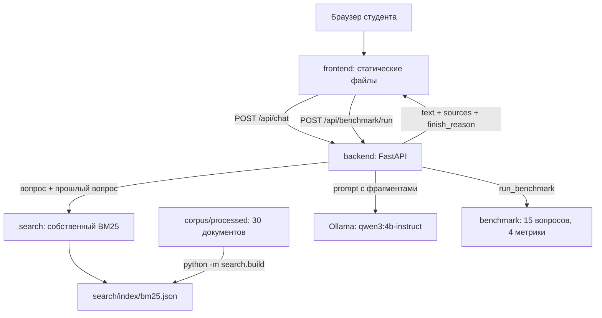

# Архитектура

## Статус

К точке 2 реализованы корпус, собственный BM25-поиск, backend на FastAPI с вызовом LLM через Ollama и benchmark, который запускается из консоли и через API. Подключение интерфейса к API — в работе ([ТЗ точки 2](../../docs/checkpoint-2.md), задачи F1–F2).

## Компоненты

| Компонент | Технология | Порт | Данные |
| --- | --- | --- | --- |
| frontend | HTML, CSS, JS | 8080 | Нет; история в `localStorage` |
| backend | Python 3.12, FastAPI, Uvicorn | 8000 | Прогоны benchmark в памяти процесса |
| search | Python-модуль внутри backend | — | `search/index/bm25.json`, загружается один раз при старте |
| llm | Ollama, `qwen3:4b-instruct` | 11434 | Веса модели в `~/.ollama` |
| indexer | `python -m search.build` | — | Читает `corpus/`, пишет индекс |
| benchmark | `benchmark/run.py` | — | Пишет `benchmark/results/` |

Поиск — модуль внутри backend, а не отдельный сервис: это проще для небольшой команды (решение D04).

## Путь запроса

1. Frontend отправляет `POST /api/chat` с вопросом и историей диалога.
2. Backend проверяет текст: не пустой, не длиннее 2000 символов, иначе 400.
3. BM25 возвращает top-5 фрагментов с metadata (документ, страница, покрытие запроса).
4. Если покрытие у лучшего фрагмента ниже порога — отказ `no_context` без вызова LLM. Для уточняющего вопроса поиск повторяется вместе с прошлым вопросом пользователя.
5. Иначе собирается prompt: инструкция, фрагменты `[1]…[5]` с документом и страницей, последние 6 сообщений, вопрос.
6. LLM отвечает только по фрагментам или фразой «В документах нет этой информации.» — тогда тоже `no_context`.
7. Backend возвращает `text`, `sources` (из metadata фрагментов, на которые сослалась модель) и `finish_reason`.
8. Frontend показывает ответ и источники и сохраняет диалог в истории.

Ollama недоступна или не ответила за `OLLAMA_TIMEOUT` → 503; индекс не собран → 503.

## Benchmark в рантайме

`POST /api/benchmark/run` запускает `run_benchmark()` в фоновом потоке и сразу возвращает `run_id`. В режиме `full` ответы берутся из той же функции `answer()`, что и в чате, — benchmark проверяет ровно то, что видит пользователь. Одновременно идёт один прогон (повторный запрос → 409). Статус и прогресс — `GET /api/benchmark/runs/{run_id}`. Полный прогон 15 вопросов на MacBook Pro M3 (8 ГБ) — около 2 минут.

## Подготовка корпуса

1. Исходные PDF и DOCX лежат у команды в папке материалов семестра и в Git не попадают.
2. `python -m corpus.extract --source <папка>` извлекает текст постранично в `corpus/processed/Dxx.jsonl` и обновляет `manifest.json` с хешами исходников.
3. `python -m search.build` делит текст на фрагменты ~1000 символов, лемматизирует и строит индекс.

Подробнее — [rag.md](rag.md), [corpus/README.md](../../corpus/README.md).

## Размещение

Для защиты всё запускается на ноутбуке Сейрана (MacBook Pro M3, 8 ГБ): Ollama, backend и frontend локально. Модель выбрана так, чтобы помещаться в память вместе с остальными процессами (решение D14).

## Безопасность

- Демо-авторизация прототипа не защищает данные; полноценный вход — следующий этап.
- Ответ модели выводится как текст, не как HTML.
- Фрагменты передаются модели как данные; prompt запрещает отвечать вне них.
- В корпус не попадают персональные данные студентов.
- CORS backend разрешает только адрес frontend (`CORS_ORIGINS`).
- Backend слушает только `localhost`; наружу не публикуется.
