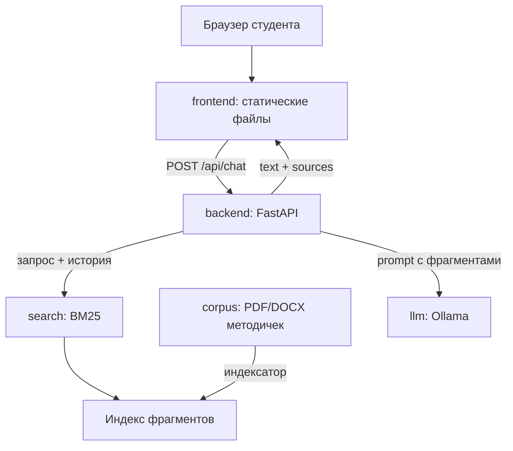

# Архитектура

## Статус

Это целевая архитектура для реализации. На точке 1 в репозитории есть документация и статический прототип интерфейса; backend, поиск и LLM ещё не реализованы.

## Компоненты

| Компонент | Технология | Порт (dev) | Данные |
| --- | --- | --- | --- |
| frontend | HTML, CSS, JS | 8080 | Нет; история в `localStorage` |
| backend | Python 3.12, FastAPI, Uvicorn | 8000 | Конфигурация |
| search | Python-модуль внутри backend на первом этапе | — | Индекс на диске, только чтение |
| llm | Ollama | 11434 | Локальные веса модели |
| indexer | Python-скрипт, запускается вручную | — | Читает `corpus/`, пишет индекс |

На первом этапе поиск — модуль внутри backend, а не отдельный сервис: это проще для небольшой команды. Выделение в отдельный сервис записывается в [журнал решений](../decisions.md), если понадобится.

## Путь запроса

1. Frontend отправляет `POST /api/chat` с вопросом и историей диалога.
2. Backend проверяет текст (не пустой, не длиннее лимита).
3. Из вопроса и последних сообщений формируется поисковый запрос.
4. BM25 возвращает top-k фрагментов с metadata (документ, страница, раздел).
5. Если подходящих фрагментов нет — backend возвращает отказ без вызова LLM.
6. Иначе собирается prompt: инструкция, фрагменты с номерами, вопрос.
7. LLM генерирует ответ; backend возвращает `text` и список `sources`.
8. Frontend показывает ответ и источники и сохраняет диалог в истории.

## Подготовка корпуса

1. Документы кафедры складываются в `corpus/raw/` (PDF, DOCX).
2. Индексатор извлекает текст с сохранением номеров страниц.
3. Текст делится на фрагменты по заголовкам и размеру.
4. Каждый фрагмент получает metadata: `doc_id`, `title`, `discipline`, `doc_type`, `page`, `section`.
5. Токены лемматизируются, строится BM25-индекс, индекс сохраняется на диск.

Подробнее — [rag.md](rag.md).

## Размещение

Для разработки всё запускается локально на компьютере участника. Для показа — на одном компьютере команды или сервере кафедры с GPU, если он будет доступен. Модель LLM выбирается так, чтобы помещаться в доступную память; выбор фиксируется в [журнале решений](../decisions.md).

## Безопасность

- Демо-авторизация прототипа не защищает данные; в рабочей версии вход проверяет backend.
- Ответ модели выводится как текст, не как HTML.
- В корпус не попадают персональные данные студентов.
- CORS backend разрешает только адрес frontend.
